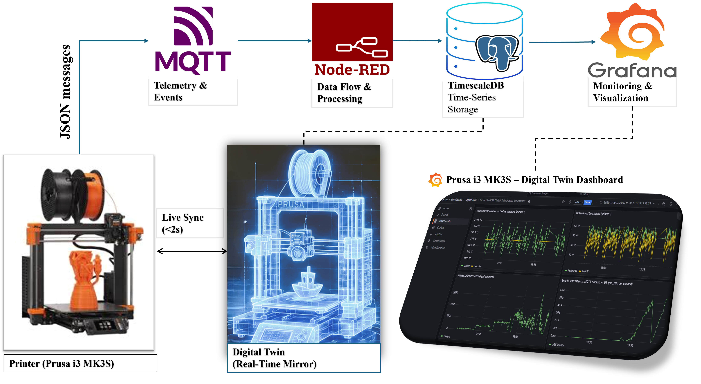

# Real-Time Digital Twin for Fused Deposition Modeling

Code, configurations, and result files that accompany a journal article on an open-stack, real-time digital twin (DT) for a Prusa i3 MK3S fused deposition modeling (FDM) printer:

> A. K. Menghwar, M. Alkahtani, M. Z. Hasan, M. Kh. Almatani,
> **"Real-Time Digital Twin for Fused Deposition Modeling: Replay-Based Performance Evaluation and Data Requirements for Telemetry-Driven Prognostics."**

The repository contains the DT pipeline (MQTT → Node-RED → TimescaleDB → Grafana), the record-and-replay benchmark used to measure its real-time performance, and the analysis scripts and aggregated results behind the tables and figures of the article. The raw telemetry is not included (see [Data availability](#data-availability)).

<p align="center"></p>
<p align="center"><sub>Conceptual overview (illustration; dashboard values are schematic).</sub></p>

---

## Architecture

The implementation covers the first three layers of the Causal Digital Twin Framework (CDTF), see `docs/figures/`.

| Layer (CDTF) | Component | Folder |
|---|---|---|
| 1. Data acquisition and integration | Event-based telemetry log (OctoPrint and power instrumentation), MQTT (Eclipse Mosquitto) | `1_pipeline/` |
| 2. Cyber-physical synchronization | Node-RED time-stamping and mapping, TimescaleDB hypertable | `1_pipeline/`, `5_replay_benchmark/` |
| 3. Analytics and monitoring | Session-aware preprocessing, one-minute windowed features, regression models, prediction storage, threshold alerts, Grafana dashboards | `2_preprocessing/`, `3_experiments/`, `4_diagnostic_analysis/` |
| 4. Causal inference | Future work | – |

## Main results

**Real-time performance** (replay of recorded telemetry at 76 events/s per virtual printer; one laptop, Intel Core i7-8550U, 16 GB RAM, Docker):

| Virtual printers | Offered (msg/s) | Loss | Latency p50 | Latency p95 |
|---|---|---|---|---|
| 1 | 77 | 0 % | 2.2 ms | 5.1 ms |
| 5 | 383 | 0 % | 1.6 ms | 5.0 ms |
| 10 | 766 | 0 % | 1.7 ms | 1.1 s |
| 20 | 1,532 | 0 % | saturated (≈1,100 rows/s) | |
| 40 | 3,063 | 0 % | saturated | |

**Prognostic target analysis.** A telemetry-only session-progress target is not predictable on held-out sessions (R² = −0.59). The causes are a unit mismatch (a session contains several print jobs and idle periods), covariate shift in idle share, and cumulative signals masked by job-dependent offsets. A job-level target with job context from G-code metadata reaches R² = 0.88 on the holdout (0.90 in leave-one-session-out validation). Physically motivated health indicators show no degradation trend in the recorded period.

## Data overview

| Data | Size | Used for |
|---|---|---|
| Raw event log | 10.07 M records, 23 sessions (22 analysed, ≈114 h) | Acquisition analysis, replay benchmark |
| Cleaned records | 9.68 M records | Experiment A (within-session) |
| One-minute windows | 6,879 windows, 89 predictors | Experiment B and diagnostic analyses |

## Repository structure

```
1_pipeline/              DT pipeline scripts: replay to MQTT/TimescaleDB, feature upload,
                         threshold alert monitor, Node-RED and Grafana configurations
2_preprocessing/         01 event-log cleaning, 02 session-aware feature engineering,
                         03 session summary
3_experiments/           Experiment A (within-session) and B (one-minute windows,
                         cross-session); feature-target correlations; result files
4_diagnostic_analysis/   Failure diagnosis, job-level target and job context,
                         leave-one-session-out validation, noise robustness,
                         health indicators; result files and figures
5_replay_benchmark/      Docker Compose stack (Mosquitto, Node-RED, TimescaleDB, Grafana)
                         and benchmark client; benchmark results and figures
docs/figures/            Overview, framework, acquisition and analytics-layer figures
data/                    Empty: dataset available on request (see data/README.md)
```

## Getting started

1. Install Python 3.10+ and the packages in `requirements.txt`.
2. Copy `.env.example` to `.env`, enter your own database and (optional) e-mail settings, and load them as environment variables. Never commit `.env`.
3. Place the dataset files (available on request) in `data/`, or set `DT_DATA_DIR` to their folder.
4. Run the scripts in numbered order. Outputs are written to `results/` (or `DT_RESULTS_DIR`).

### Replay benchmark

Requires Docker Desktop and the replay segment (part of the dataset on request) in `5_replay_benchmark/data/`. See `5_replay_benchmark/README.md`.

```bash
cd 5_replay_benchmark
docker compose up -d --build
docker compose run --rm bench
docker compose down -v
```

## Data availability

The telemetry was recorded on an instrumented Prusa i3 MK3S in a university laboratory between March 2023 and January 2024. **The dataset is not included in this repository.** It is available from the corresponding author on reasonable request, subject to the agreement of the data owner. The repository contains only aggregated results (metrics, correlations, per-session summaries) and no raw or windowed telemetry.

## Contact

Atam Kumar Menghwar (mngtkm01m14z236b@studenti.unical.it)

© 2026 The authors. All rights reserved unless stated otherwise.
